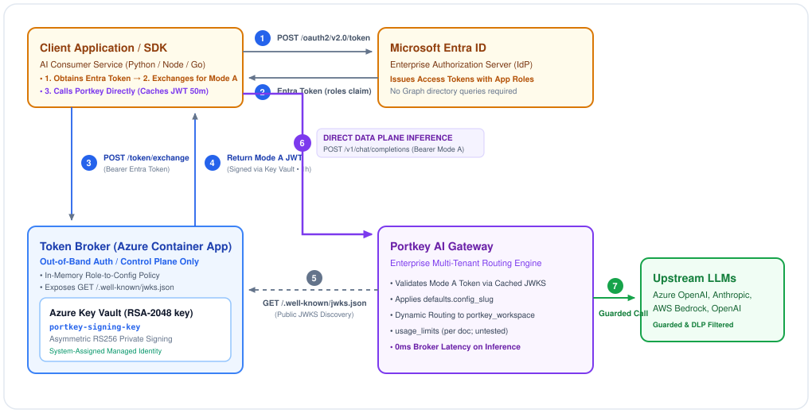

# Microsoft Entra ID to Portkey Mode A integration: design background

Architecture, why Entra can't issue Mode A tokens itself, and the broker design. Entra ID is the identity provider, and a small token broker on Azure turns an Entra token into a [Portkey Mode A JWT](https://portkey.ai/docs/product/enterprise-offering/org-management/jwt), signed by an asymmetric Key Vault key. The related standard is [RFC 8693, OAuth 2.0 Token Exchange](https://datatracker.ietf.org/doc/html/rfc8693).

This page is the original architecture handoff, corrected after the build and tests. The build steps are in the [README](../README.md).

## Status 2026-10-23: built and tested; this page was corrected to match

The design below was implemented as a Container App with a Key Vault signing key and Terraform (see the article README), and tested against a hybrid gateway 2.29.0. The original handoff was a design with untested code. Corrections made here:

- The hybrid gateway reads `defaults.config_slug` and ignores `defaults.config_id`. Put the slug in the policy.
- "Tamper-proof config" is not established. The Portkey doc says a config sent in a request header can override the token's default unless config override is disabled; that was not tested.
- "Mode B forces one gateway per workspace" is only partly right per the doc (workspace can come from an allowlist, an org default or a `sub` mapping). Mode B with Entra's own JWKS was not tested.
- Scope names must be gateway scopes (`logs.read`, not `logs.view`). `usage_limits` is an array in the doc; the object shape in the original sketch is wrong, and enforcement was not tested.
- A user token for a workspace the user isn't a member of gets 403 (code 033) unless the gateway runs with `JWT_JIT_USER_ACCESS=ON` (documented under [Workspace resolution](https://portkey.ai/docs/product/enterprise-offering/org-management/jwt#workspace-resolution)), which admits it as a service key and trades per-user attribution for availability.
- The original sketch passed raw bytes to Key Vault's RS256 sign (it expects a digest), used the key *name* as `kid` (it must change with the key version), returned error messages to the caller and gave unmatched callers a default tier. The broker hashes first, uses the key version as `kid`, returns error codes only and refuses callers with no matching role.
- Not tested: SaaS, key rotation, JWKS cache lifetimes, `usage_limits`, per-user attribution under JIT, config override by header, dead ends 1 and 2 (taken from the original handoff and Microsoft's documentation).

## 1. Objective and context

The goal is to use **Microsoft Entra ID** as the enterprise identity provider (IdP) for the **Portkey AI Gateway** through [Mode A JWT authentication](https://portkey.ai/docs/product/enterprise-offering/org-management/jwt). In Mode A the token issuer embeds gateway-aware claims in a signed JWT. These claims decide tenant routing, access scopes and the default config before a request reaches an upstream model.

Portkey Mode A JWT payload (the hybrid gateway reads `config_slug`; the `usage_limits` shape is from the doc, untested):

```json
{
  "portkey_oid": "org_xxxxxxxx-xxxx-xxxx-xxxx-xxxxxxxxxxxx",
  "portkey_workspace": "production-finance",
  "email_id": "user@contoso.example",
  "scope": ["completions.write", "logs.read"],
  "defaults": {
    "config_slug": "pc-finance-strict-dlp",
    "config_id": "pc-finance-strict-dlp",
    "metadata": {
      "cost_center": "CC-9021",
      "department": "RiskAnalytics"
    }
  },
  "usage_limits": [
    { "id": "ul-1", "type": "cost", "credit_limit": 250, "status": "active" }
  ]
}
```

## 2. Why Mode A and `config_id` are worth it

**Shared gateway density and multi-tenancy.** One Portkey gateway can serve many workspaces. In Mode A the token carries the `portkey_workspace` claim, so one shared gateway routes by token claims alone, without a gateway per workspace.

**Governance through `defaults.config_slug` / `config_id`.** A Portkey config sets model routing, fallbacks, prompt templates and guardrails (PII redaction, jailbreak filters). If it travels in an HTTP header (`x-portkey-config`), a client can change or omit it. Putting it in a **signed JWT** makes it a default the client can't edit inside the token. Per the Portkey doc, a config sent in a request header can still override it unless config override is disabled for the workspace (not tested here), so treat it as a default, not a lock.

## 3. Explored approaches and dead ends

Making Entra the native Mode A token issuer isn't viable, because of schema limits in Entra's token pipeline. Three avenues were considered. Dead ends 1 and 2 come from the original handoff and Microsoft's documentation and were not reproduced in the lab.

### Dead end 1: Entra claims mapping policy (rejected)

**Attempt:** an app registration with `acceptMappedClaims: true` and a Graph `claimsMappingPolicy` that emits custom keys (`portkey_oid`, `defaults`).

**Why it failed:** Entra's `ClaimsSchema` only allows flat, primitive key-value mappings (strings, integers, booleans). It can't emit nested JSON such as `defaults: { config_id: "..." }`.

### Dead end 2: Entra custom claims provider, `onTokenIssuanceStart` (rejected)

**Attempt:** a custom authentication extension that calls an Azure Function during token issuance to add complex Portkey claims.

**Why it failed:** the Graph custom extension event schema (`provideClaimsForToken`) validates outgoing claims strictly. Claim types are limited to scalars (`string`, `boolean`, `integer`) or flat collections (`string[]`). Nested JSON dictionaries abort token issuance with schema errors.

### Dead end 3: fall back to Portkey Mode B (claim corrected, untested with Entra's JWKS)

**Attempt:** Mode B, where Portkey accepts an unmodified Entra token and maps the workspace through gateway environment variables (`ORGANISATIONS_TO_SYNC`).

**Why it is less attractive:** per the Portkey doc, Mode B needs one organisation per gateway, but the workspace can come from a workspace allowlist, an org default or a `sub` mapping, so "one gateway per workspace" is only partly right. The IdP's token can't carry `defaults.config_slug`, so the per-team config has to come from elsewhere. Tested: a raw Entra token sent to a gateway whose org JWKS list has no Entra key gets 401 (no matching key). Mode B with Entra's JWKS configured was not tested.

## 4. Target architecture: out-of-band token broker and direct data plane

The broker is **never an in-band proxy** for AI traffic. It works only in the control/auth plane. The client calls the broker once at boot (and refreshes every 50 minutes) to exchange its Entra token for a Mode A JWT, then caches it. All high-throughput inference calls (`/v1/chat/completions`) go **directly from the client to the Portkey gateway**, with no broker in the path.

Following [RFC 8693](https://datatracker.ietf.org/doc/html/rfc8693) and the [Portkey Mode A JWT specification](https://portkey.ai/docs/product/enterprise-offering/org-management/jwt), the diagram shows the split: the control plane exchanges and signs the token, Portkey fetches the broker's JWKS out-of-band, and the data plane carries inference straight from client to gateway.



Legend: amber = identity and auth (client, Entra ID); blue = out-of-band token broker (Container App and Key Vault); purple = Portkey gateway, and the direct data plane (inference) arrow; green = protected upstream LLMs; dashed = out-of-band JWKS discovery.

| Steps | What happens |
|---|---|
| 1 and 2, Entra auth | The client authenticates with client credentials or an OAuth authorization code flow. Entra returns a standard JWT that carries the enterprise role assignments in the `roles` claim. |
| 3 and 4, token minting | The client calls `POST /token/exchange` at boot. The broker maps roles to the Portkey workspace and `defaults.config_slug`, signs the token through Key Vault (RS256) and returns a Mode A JWT. The client caches it for 50 minutes. |
| 5, JWKS discovery | Portkey fetches the broker's public RSA key from `/.well-known/jwks.json` and uses it to verify signatures. The cache lifetime was not measured; a newly added JWKS URL was accepted on the first request. |
| 6 and 7, direct data plane | The client sends inference requests **directly to the Portkey gateway** with the cached Mode A JWT. The broker is never in the request path. The gateway validates the JWT, applies `defaults.config_slug` and routes to the upstream. |

## 5. Entra ID service principal and app roles design

**Key insight: app roles instead of Graph directory queries.** The broker does **not** need directory-reading permissions (`User.Read.All`, `Directory.Read.All`) on Microsoft Graph. Querying Graph at runtime adds 150-300 ms of latency and risks throttling. In large enterprises with more than 150-200 groups, Entra also drops the `groups` claim (group overage). **App roles are never omitted**, which makes them the most reliable carrier of governance context.

Configuration steps in Entra ID:

1. **Register the app.** Create an app registration named `Portkey-Token-Broker` with Application ID URI `api://portkey-token-broker`.
2. **Declare app roles.** Under *App roles*, add roles that stand for Portkey workspaces: `Portkey.Workspace.Finance` and `Portkey.Workspace.HR` (the lab build used Finance and HR; `entra/setup.sh` creates them).
3. **Assign enterprise groups.** Under *Enterprise applications*, assign existing security groups (for example "SG-FinAnalytics") to their app roles. Entra emits them in the `roles` array (observed for both app and user tokens; Microsoft's doc says group assignment needs Entra ID P1, but it worked on the Free-tier lab tenant).
4. **Require assignment.** Turn on "assignment required" so Entra refuses callers with no role before the broker sees them (observed: `AADSTS501051` for apps, `AADSTS50105` for users).

## 6. Azure-native implementation

The implementation is a plain Node 20 HTTP service in `broker/` (TypeScript, container image on Azure Container Apps, system-assigned identity with Key Vault Crypto User), not the Azure Functions v4 code of the original sketch. It exposes `POST /token/exchange`, `GET /.well-known/jwks.json` and `GET /healthz`. The sketch is removed from this page because it had the defects listed in the status section above; the source of truth is the repo.

## 7. Standards and references

- [Portkey docs: Mode A JWT authentication](https://portkey.ai/docs/product/enterprise-offering/org-management/jwt): Mode A and Mode B specifications, required claims (`portkey_oid`, `portkey_workspace`, `defaults.config_id`) and JWKS verification.
- [IETF RFC 8693: OAuth 2.0 Token Exchange](https://datatracker.ietf.org/doc/html/rfc8693): the protocol for a security token service that accepts one token and returns another.
- [Azure Architecture: Federated Identity pattern](https://learn.microsoft.com/en-us/azure/architecture/patterns/federated-identity): separates central corporate auth from application-specific token services.
- [Azure Architecture: Gateway Offloading pattern](https://learn.microsoft.com/en-us/azure/architecture/patterns/gateway-offloading): moves identity normalization and token mediation away from downstream services.
- [Azure Key Vault cryptographic operations](https://learn.microsoft.com/en-us/azure/key-vault/keys/about-keys-secrets-certificates#key-operations): signing token digests in FIPS 140-2 validated HSMs without exposing the private key.
- [Microsoft Entra ID: custom claims provider reference](https://learn.microsoft.com/en-us/entra/identity-platform/custom-claims-provider-reference): the schema limit that custom claims must be scalar types or flat arrays, which is why Entra can't emit nested objects.

## 8. Open decisions and next steps

1. **Key signing strategy.** The build signs with Key Vault on every exchange (a digest is hashed locally and signed in the vault, so the private key never leaves it). Exchange latency was not measured; the client caches the token, so inference calls don't pay it. Cached-key signing in memory remains an option if exchange latency matters.
2. **JWKS network reachability.** With Portkey Cloud (SaaS), the broker's `/.well-known/jwks.json` must be publicly reachable over HTTPS. The tests ran with a public endpoint and a hybrid gateway; Mode A on SaaS (control-plane validation) and a private-endpoint variant for a self-hosted gateway in AKS were not tested.
3. **Client SDK lifecycle.** Have client SDK wrappers (Python/TypeScript) request a Mode A token at boot and refresh it every 50 minutes, keeping it in memory across inference requests to avoid cold-start overhead.
4. **User attribution vs availability.** User tokens (with `email_id`) need workspace membership by default (403, code 033 otherwise). `JWT_JIT_USER_ACCESS=ON` removes that requirement by admitting the caller as a workspace service key. Decide whether per-user attribution matters, and check the logs: it was not verified under JIT.
